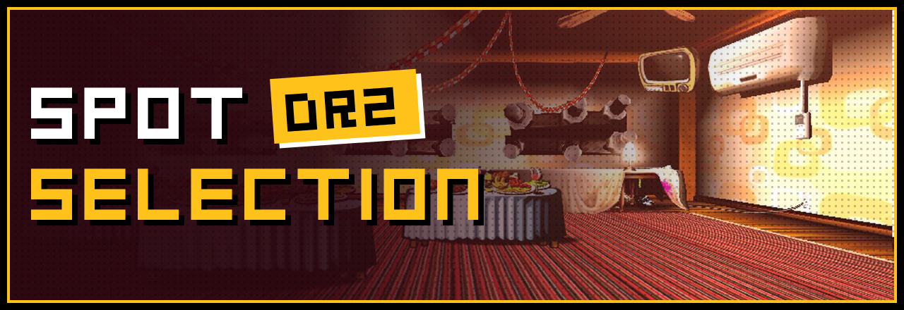
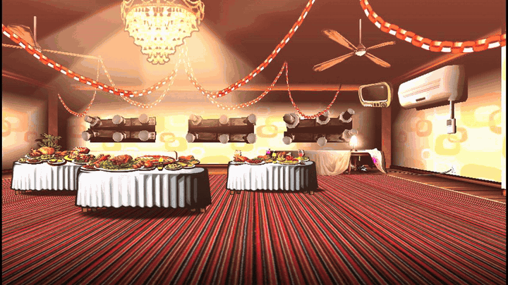

  

  
  
  

  

  

---

## 💬 Credits

- **kfcbathroom**: Spot Selection DR2 minigame
- **[Power2015](https://github.com/Power2015Dev)** and **[FreddysDark-on](https://github.com/FreddysDark-on)**: Danganmake and the minigame template
- [Danganmake documentation](https://power2015dev.github.io/Danganmake-Engine/content.html)

Danganronpa is © Spike Chunsoft. This is a fan-made minigame and is not affiliated with Spike Chunsoft.
