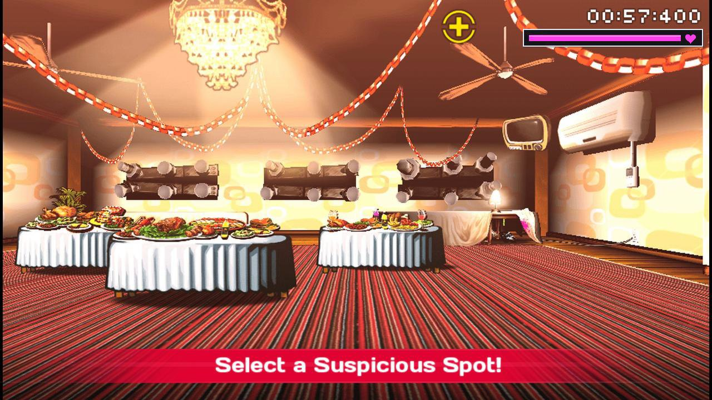
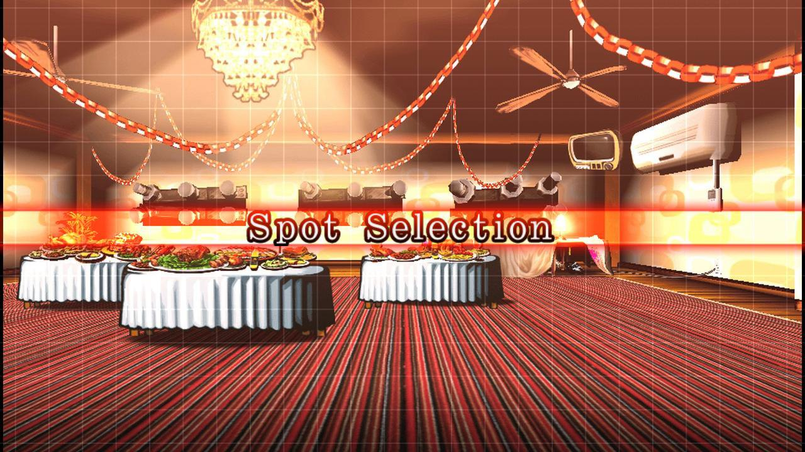
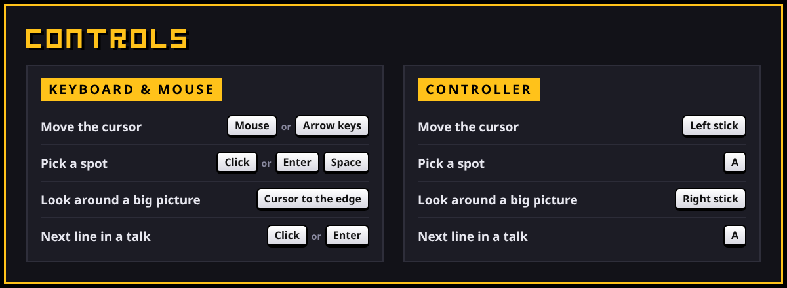
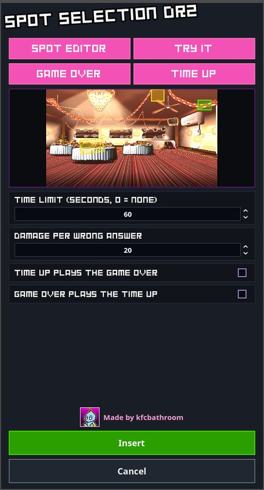
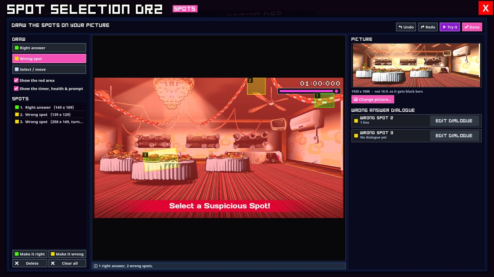

  

  
  
  

  

  

---

## 🔍 What is it?

**Spot Selection DR2** is Danganronpa 2's *"Select a Suspicious Spot!"* for your Danganmake trials. A picture of the scene comes up and the player has to find the one thing that's wrong with it before the clock runs out. Picking the wrong spot costs health, and each wrong spot can have its own lines explaining why it isn't the answer.

## ✨ Features

- 🎯 **DR2-style Spot Selection.** The *"Spot Selection"* intro, the target cursor, the *"Select a Suspicious Spot!"* prompt, the timer and the health bar.
- 🖼️ **Any picture.** 1920 × 1080 fills the screen. A wider or taller picture scrolls when the cursor reaches the edge.
- 🟩 **Spot editor.** Draw the right answer in green and wrong spots in yellow. Move, resize and turn the boxes, with undo and redo.
- 💬 **Lines for wrong spots.** Each wrong spot can say why it's wrong, written with Danganmake's own dialogue editor.
- 💀 **Game Over and Time Up events.** Lines, music, HUD, character sprites and the *"Would you like to retry?"* question.
- ▶️ **Try it.** Play your spot right inside the editor. Nothing is saved and no health is lost.
- 🎮 **Controller support.** Left stick for the cursor, right stick to look around big pictures.

## 📸 Screenshots

<table>
  <tr>
    <td width="50%"></td>
    <td width="50%"></td>
  </tr>
  <tr>
    <td align="center">Move the cursor and pick the suspicious spot</td>
    <td align="center">The DR2 "Spot Selection" intro</td>
  </tr>
</table>

## 📥 How to install

Don't have Danganmake yet? **[Get it on itch.io](https://freddysdarkon.itch.io/danganmake)**.

1. Go to the **[Releases page](https://github.com/kfcbathroom25/danganmake-spotselectiondr2/releases/latest)** and download the latest `.zip`.
2. Unzip it.
3. Drop the folders inside into your Danganmake **mods assets** folder.
4. That's it! **Spot Selection DR2** now shows up in Danganmake's minigames.

> [!TIP]
> When a new version comes out, download it the same way and replace the old folders.

## 🎮 Controls

  

Controls as text

| Action | Keyboard & mouse | Controller |
| --- | --- | --- |
| Move the cursor | Mouse / arrow keys | Left stick |
| Pick a spot | Click / Enter / Space | A |
| Look around a big picture | Move the cursor to the edge | Right stick |
| Next line in a talk | Click / Enter | A |

## 🖌️ Make your own spot

Insert the minigame in Danganmake's editor and its settings open:

<table>
  <tr>
    <td width="32%" valign="top"></td>
    <td valign="top">
      <ul>
        <li><b>Spot Editor:</b> choose the picture and draw the spots.</li>
        <li><b>Try It:</b> play it right there.</li>
        <li><b>Game Over / Time Up:</b> what happens when health or time runs out.</li>
        <li><b>Time limit / Damage:</b> 0 seconds means no time limit, and the clock counts up instead.</li>
      </ul>
      
Press <b>Insert</b> to save it into your trial.

    </td>
  </tr>
</table>

### The spot editor

1. Press **Change picture...** and pick your PNG.
2. Choose **Right answer** and drag a box over the suspicious spot (green).
3. Choose **Wrong spot** and drag boxes over the things that look suspicious but aren't (yellow).
4. Press **Edit dialogue** next to a wrong spot to write what's said when someone picks it.
5. Press **Try it** to play it, then **Done**.

## 🐞 Found a bug?

**[Report it here](https://github.com/kfcbathroom25/danganmake-spotselectiondr2/issues/new?template=bug_report.yml)**. A short form asks what happened and how to make it happen again. Screenshots or a video help a lot.

## 🎲 More minigames

| Minigame | |
| --- | --- |
| **[Closing Argument V3](https://github.com/kfcbathroom25/danganmake-closingargumentv3)** | V3's comic-book Closing Argument: rebuild the case one panel at a time. |
| **[Closing Argument DR2](https://github.com/kfcbathroom25/danganmake-closingargumentdr2)** | DR2's manga Closing Argument: drop the missing panels into the pages. |

**[See every minigame by kfcbathroom](https://github.com/kfcbathroom25?tab=repositories&q=danganmake-&type=source)**

## 💬 Credits

- **kfcbathroom**: Spot Selection DR2 minigame
- **[Power2015](https://github.com/Power2015Dev)** and **[FreddysDark-on](https://github.com/FreddysDark-on)**: Danganmake and the minigame template
- [Danganmake documentation](https://power2015dev.github.io/Danganmake-Engine/content.html)

Danganronpa is © Spike Chunsoft. This is a fan-made minigame and is not affiliated with Spike Chunsoft.
